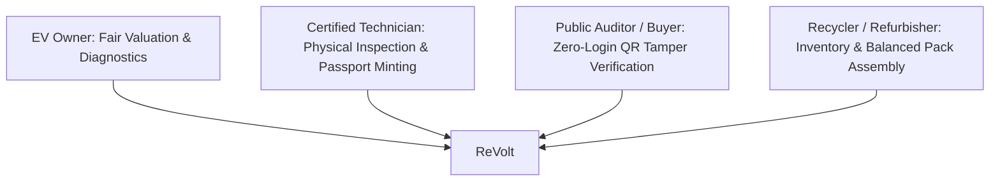

# REVOLT Platform — Hackathon Demonstration Runbook

> **Platform Version:** 1.0.0 (Production Hackathon Release)  
> **Target Audience:** Hackathon Judges, Evaluators, Engineering Auditors, Industry Stakeholders  
> **Repository:** `d:\battery_second\battery_second` | Branch: `feat-integration`

---

## 1. Executive Summary & Value Proposition

**ReVolt** is an end-to-end, safety-first intelligence and circularity platform for Second-Life Electric Vehicle (EV) batteries. Addressing the multi-billion dollar challenge of EV battery decommissioning, ReVolt bridges the critical gap between retired automotive packs, certified second-life applications (such as solar microgrids and light EVs), and hydrometallurgical recycling.

### Core Architectural Pillars:
1. **Multi-Mode Telemetry Acquisition:** Supports physical hardware serial feeds, recorded laboratory CSV replay, and virtual equivalent-circuit emulation.
2. **Decoupled Health Intelligence:** Eliminates the naive assumption that $SOH \equiv \text{Capacity}$. Computes true Coulombic integration alongside empirical health estimation with strict confidence scoring.
3. **Safety-Constrained Decision Solver:** Governed by an immutable safety-first finite state machine. Safety checks (`PASSED`, `WARNING`, `FAILED`, `UNKNOWN`) strictly override economic optimization (`UNKNOWN` is never treated as safe).
4. **Physics-Informed Arrhenius & Wöhler What-If Simulation:** Projects calendar and cyclic degradation under variable ambient temperatures and depth-of-discharge (DOD) regimes.
5. **Cryptographic Digital Battery Passport:** Tamper-evident SHA-256 verification hash and transparent audit trail enabling instant, zero-login public verification.
6. **Variance-Minimized Cell Sorting:** Automates recycler pack assembly by grouping heterogeneous cells into balanced 4S/N-S packs satisfying $\sigma_{SOH} \le 3.0\%$.

---

## 2. Platform Architecture & Port Directory

| Service | Port / URL | Purpose |
| :--- | :--- | :--- |
| **Frontend Portal** | `http://localhost:5173` | React/Vite dashboard, live telemetry visualizer, passport audit |
| **REST API Engine** | `http://127.0.0.1:8000` | FastAPI asynchronous business logic & safety engine |
| **Interactive API Docs**| `http://127.0.0.1:8000/docs` | Swagger UI for live REST contract inspection |
| **Passport Verification**| `http://localhost:5173/verify/{battery_id}` | Zero-login public verification interface |
| **MongoDB Datastore** | `mongodb://localhost:27017` | `revolt_db`: `batteries`, `reports`, `tests`, `inventory`, `exchanges` |

---

## 3. One-Click Launch & Teardown

### Starting the Platform
Launch via PowerShell or Windows Batch:
```powershell
# From repository root:
powershell -ExecutionPolicy Bypass -File scripts\run_platform.ps1
```
Or double-click `scripts\run_platform.bat`.

### Stopping the Platform
```powershell
powershell -ExecutionPolicy Bypass -File scripts\stop_platform.ps1
```

---

## 4. The 4 Stakeholder Personas



1. **EV Owner (e.g., Aditya Sharma):** Seeks rapid non-destructive health assessment, transparent valuation breakdowns in INR without opaque middleman cuts, and instant exchange credits.
2. **Certified Inspection Technician (e.g., TECH-BLR-02):** Connects testing bench or initiates 90s screening protocol, validates physical and thermal parameters, and digitally signs inspection certificates.
3. **Public Auditor / Secondary EV Buyer:** Scans QR code to inspect unalterable battery provenance, historical test signatures, and manufacturer specifications without needing platform credentials.
4. **Battery Recycler / Refurbisher:** Manages large batches of decommissioned cells, filters safe candidates from scrap, and automatically clusters cells into balanced battery packs.

---

## 5. Guided Demonstration Scenarios

### Scenario 1: Fast 90-Second Screening & Live Telemetry (`BAT-101`)
* **Persona:** EV Owner & Technician
* **Subject:** Tata AutoComp LFP 50.0 Ah Pack (Source: Tata Nexon EV Prime)
* **Goal:** Demonstrate live hardware streaming, rapid SOH estimation, and dynamic UI updates.
* **Steps:**
  1. Navigate to `http://localhost:5173` and locate `BAT-101` (Status: *Awaiting Screening*).
  2. Click **Start 90s Diagnostic Test**.
  3. Observe real-time telemetry streaming:
     - Voltage ($V$), Current ($I$), Temperature ($T$), and $dT/dt$.
     - Live plot rendering with dynamic color-coded thresholds.
  4. At $t = 90\text{s}$, the system terminates data acquisition, calculates Coulombic integration:
     $$Q = \int I \, dt$$
     and applies the 90s SOH correlation model.
  5. The platform displays:
     - **Estimated SOH:** ~88–92%
     - **Available Capacity:** ~44.5 Ah
     - **Safety Status:** `PASSED`
     - **Recommended Action:** `CONTINUE_EV` or `SECOND_LIFE_STORAGE`

---

### Scenario 2: Physics-Based Arrhenius/Wöhler What-If Simulation (`BAT-102`)
* **Persona:** Battery Asset Manager & Second-Life Storage Designer
* **Subject:** CATL NMC 60.0 Ah Pack (Source: MG ZS EV, SOH: 76.5%)
* **Goal:** Prove how Arrhenius thermal modeling and Wöhler mechanical stress curve simulate remaining useful life (RUL) under different operating conditions.
* **Steps:**
  1. Open `BAT-102` on the dashboard.
  2. Notice the initial recommendation: `SECOND_LIFE_STORAGE` (valuation: ₹28,400).
  3. Navigate to the **What-If Simulation Tab**.
  4. Adjust interactive parameter sliders:
     - **Ambient Temperature:** Slide from $25^\circ\text{C}$ to $45^\circ\text{C}$.
     - **Cycle Depth of Discharge (DOD):** Slide from 80% to 100%.
     - **Daily Cycling Rate:** Set to 1.5 cycles/day.
  5. Click **Simulate Lifespan**.
  6. Observe real-time Arrhenius degradation calculation:
     $$k(T) = A \cdot \exp\left(-\frac{E_a}{R \cdot T}\right)$$
     The simulation instantly charts remaining cycle life drops from ~2,400 cycles (at $25^\circ\text{C}$) to ~1,100 cycles (at $45^\circ\text{C}$), demonstrating thermal stress on NMC cathode chemistry.

---

### Scenario 3: Digital Battery Passport & Tamper-Evident Verification (`BAT-103`)
* **Persona:** Certified Technician & Secondary Buyer / Public Auditor
* **Subject:** BYD FinDreams LFP 40.0 Ah Cell (SOH: 89.4%)
* **Goal:** Demonstrate immutable auditability, technician exchange sign-off, and zero-login QR code verification.
* **Steps:**
  1. Inspect `BAT-103` on the Technician Portal (`http://localhost:5173`).
  2. View the minted **Digital Battery Passport (`PASSPORT-BAT-103-2026`)**:
     - Verified Technician ID: `TECH-BLR-02`
     - SHA-256 Provenance Hash:
       `9a7f...e3b1`
     - Approved Route: `E-Rickshaw / Light EV`
     - Approved Exchange Value: ₹32,600
  3. Click or copy the public verification link:
     `http://localhost:5173/verify/BAT-103`
  4. Open in an **Incognito / Private Browser Window** (zero credentials required).
  5. The verification badge renders **PASSPORT VERIFIED / AUTHENTIC**:
     - Clarifies that SHA-256 guarantees record integrity and tamper evidence.
  6. **Tamper Simulation Test:**
     - Make a simulated request with an invalid hash:
       `GET /api/passport/verify/BAT-103?hash=corrupted_hash_xyz`
     - The verification portal immediately flashes a red security warning: **TAMPERING DETECTED / RECORD COMPROMISED**.

---

### Scenario 4: Critical Thermal Runaway Lockout & Hydrometallurgical Recycling (`BAT-104`)
* **Persona:** Safety Officer & Recycler
* **Subject:** LG Chem NMC 45.0 Ah Cell (Source: Hyundai Kona Electric)
* **Goal:** Showcase strict safety override where critical thermal anomalies permanently lock out second-life reuse regardless of commercial value.
* **Steps:**
  1. Open `BAT-104` on the dashboard.
  2. Observe the prominent red banner:
     **CRITICAL SAFETY LOCKOUT — HAZARDOUS CONDITION DETECTED**
  3. Safety Audit Findings:
     - Peak Temperature: $T_{max} = 58.4^\circ\text{C}$ (Threshold: $> 55.0^\circ\text{C}$)
     - Thermal Velocity: $dT/dt = 0.52^\circ\text{C/s}$ (Threshold: $\ge 0.50^\circ\text{C/s}$)
     - Separator Breakdown Flag: `INTERNAL_SHORT_RISK`
  4. Highlight the Decision Override:
     - Even though remaining materials have value, the decision solver forces:
       `RECYCLE` (Hydrometallurgical extraction).
     - Second-life reuse routes (`CONTINUE_EV`, `SECOND_LIFE_STORAGE`) are strictly disabled in the UI.
     - Scrap floor valuation of ₹4,500 applied.

---

### Scenario 5: Automated Recycler Pack Grouping ($\sigma_{SOH} \le 3.0\%$)
* **Persona:** Recycler & Pack Re-manufacturer
* **Goal:** Grouping heterogeneous single cells into high-performance, variance-matched 4S packs.
* **Steps:**
  1. Open the **Recycler Inventory Portal** (`http://localhost:5173/inventory` or API `GET /api/inventory`).
  2. Observe 10+ available LFP and NMC cells in stock.
  3. Select **Group Cells for 4S Pack Assembly**:
     - Target Chemistry: `LFP`
     - Cells Per Pack: `4`
     - Maximum Permissible SOH Variance ($\sigma_{SOH}$): $\le 3.0\%$
  4. The algorithm sorts cells by SOH, evaluates sliding windows, and groups:
     - Group 1: `CELL-LFP-01`, `CELL-LFP-02`, `CELL-LFP-04`, `CELL-LFP-06`
     - Mean SOH: 88.5%, SOH Standard Deviation: $0.35\%$ ($< 3.0\%$).
     - Outlier `CELL-LFP-05` (SOH 84.1%) is safely excluded from this high-grade pack.
  5. The UI displays the assembled pack wiring schematic and estimated pack capacity.

---

## 6. Offline Fallback Architectures

For hackathon venues with restricted or unstable WiFi connectivity, ReVolt includes three offline execution layers:

1. **Virtual Battery Circuit Mode (`hardware/virtual_battery.py`):**
   - Emulates an electro-chemical RC cell with load transients, internal resistance voltage drop ($I \cdot R_{int}$), and thermal generation ($I^2 R + \text{entropic heat}$).
   - Zero physical hardware or internet connection required.
2. **Recorded Telemetry Replay Mode (`hardware/csv_replay.py`):**
   - Replays high-precision laboratory test benches from pre-recorded CSV test logs at 1x, 2x, or 10x speeds.
3. **Pre-Seeded Offline Cache (`data/seed_data.json`):**
   - Automatically loaded by the platform if the local MongoDB daemon is offline, ensuring zero disruption during live judging.

---

## 7. Judge FAQ & Technical Defense

**Q1: Why separate SOH from Capacity?**  
*Answer:* A degraded battery can show 100% state-of-charge relative to its shrunken maximum capacity, but its available Ampere-hours determine true second-life utility. We track both nominal capacity retention and empirical degradation trajectory independently.

**Q2: What prevents unsafe batteries from being certified for second life?**  
*Answer:* Our decision engine enforces a hierarchical constraint solver. Thermal runaway precursors, internal short circuits, and critical $dT/dt$ exceedances trigger unconditional `RECYCLE` or `QUARANTINE` actions before any financial or reuse optimization is evaluated.

**Q3: Is the SHA-256 Digital Passport a blockchain?**  
*Answer:* No. The SHA-256 hash is a deterministic cryptographic digest providing tamper evidence and provenance integrity for off-chain inspection records without the computational latency and transaction costs of distributed ledgers.

**Q4: How does the What-If simulation work?**  
*Answer:* It integrates an Arrhenius electro-chemical aging equation with a modified Wöhler cycle-depth stress curve to simulate SEI layer growth and active lithium loss across user-specified thermal and cycling scenarios.

