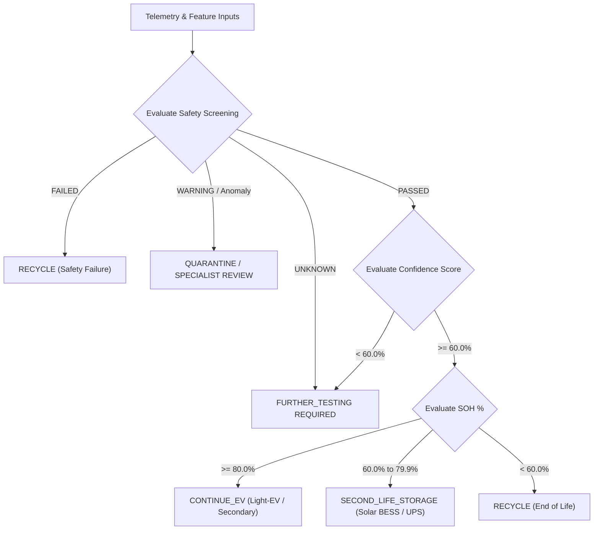

# Safety & Decision Rules: ReVolt

## 1. Safety Precedence Supremacy
The fundamental law of the ReVolt decision architecture is **Safety Precedence**:

> **Rule of Precedence:** Safety screening strictly overrides any State of Health ($SOH$) or economic recommendation. A battery with an exceptional $SOH$ (e.g. $98\%$) that exhibits thermal runaway indicators, abnormal internal resistance, or safety test failure must NEVER be authorized for reuse or second life.

---

## 2. Decision Tree & Escalation Logic

---

## 3. Detailed Decision Definitions

| Decision State | Trigger Conditions | Operational Action |
| :--- | :--- | :--- |
| `CONTINUE_EV` | `safety_status == PASSED` **AND** `confidence >= 60%` **AND** `soh >= 80%` | Approved for light-EV, e-rickshaw, or 2-wheeler repurposing. |
| `SECOND_LIFE_STORAGE` | `safety_status == PASSED` **AND** `confidence >= 60%` **AND** `60% <= soh < 80%` | Approved for stationary solar BESS, telecom backup, or UPS systems. |
| `FURTHER_TESTING` | `safety_status == UNKNOWN` **OR** `confidence < 60%` **OR** incomplete cycle | Placed in testing queue for extended multi-hour cycling test. |
| `QUARANTINE` | `safety_status == WARNING` **OR** thermal slope anomalous **OR** visual damage | Physically isolated in fire-safe containment; specialist review required. |
| `RECYCLE` | `safety_status == FAILED` **OR** `soh < 60%` | Tagged for hazardous material deconstruction and hydrometallurgical recycling. |

---

## 4. Screening Thresholds & Limits (18650 Li-ion Proof of Concept)

*Note: Threshold parameters below are baseline defaults and remain `[PENDING APPROVAL]` pending laboratory calibration with Member 3.*

| Parameter | Nominal Range | Warning Limit | Critical Failure Limit |
| :--- | :--- | :--- | :--- |
| **Max Temperature ($T_{max}$)** | $20^\circ C - 40^\circ C$ | $> 45^\circ C$ | $> 55^\circ C$ (Immediate Cutoff) |
| **Thermal Rate ($\frac{\Delta T}{\Delta t}$)** | $< 0.1^\circ C / s$ | $\ge 0.2^\circ C / s$ | $\ge 0.5^\circ C / s$ |
| **Over-voltage ($V_{max}$ NMC)** | $4.20\text{ V}$ | $> 4.25\text{ V}$ | $> 4.30\text{ V}$ |
| **Under-voltage ($V_{min}$ NMC)** | $3.00\text{ V}$ | $< 2.80\text{ V}$ | $< 2.50\text{ V}$ |
| **Over-voltage ($V_{max}$ LFP)** | $3.65\text{ V}$ | $> 3.70\text{ V}$ | $> 3.80\text{ V}$ |
| **Under-voltage ($V_{min}$ LFP)** | $2.50\text{ V}$ | $< 2.20\text{ V}$ | $< 2.00\text{ V}$ |

---

## 5. Certification Boundary Disclaimer
A 15-to-30 minute electrical and thermal bench screening test provides diagnostic indicators and rapid triage. It does **not** constitute a formal laboratory certification under automotive standards (such as UL 1973, UL 9540A, or UN 38.3). Digital Battery Passports document diagnostic screening results, not guaranteed automotive immunity.

