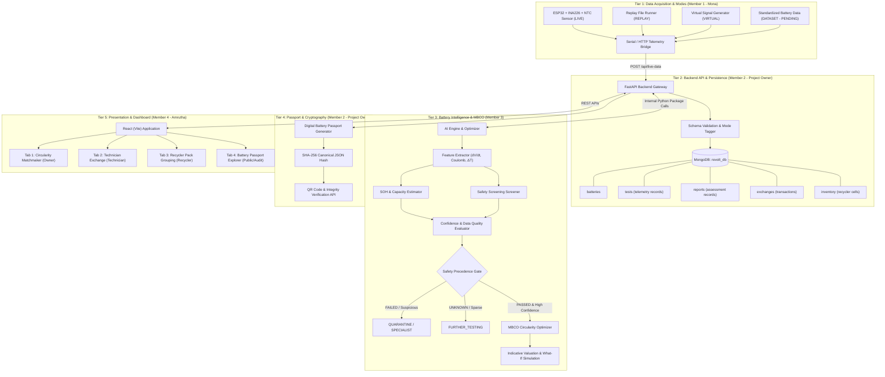
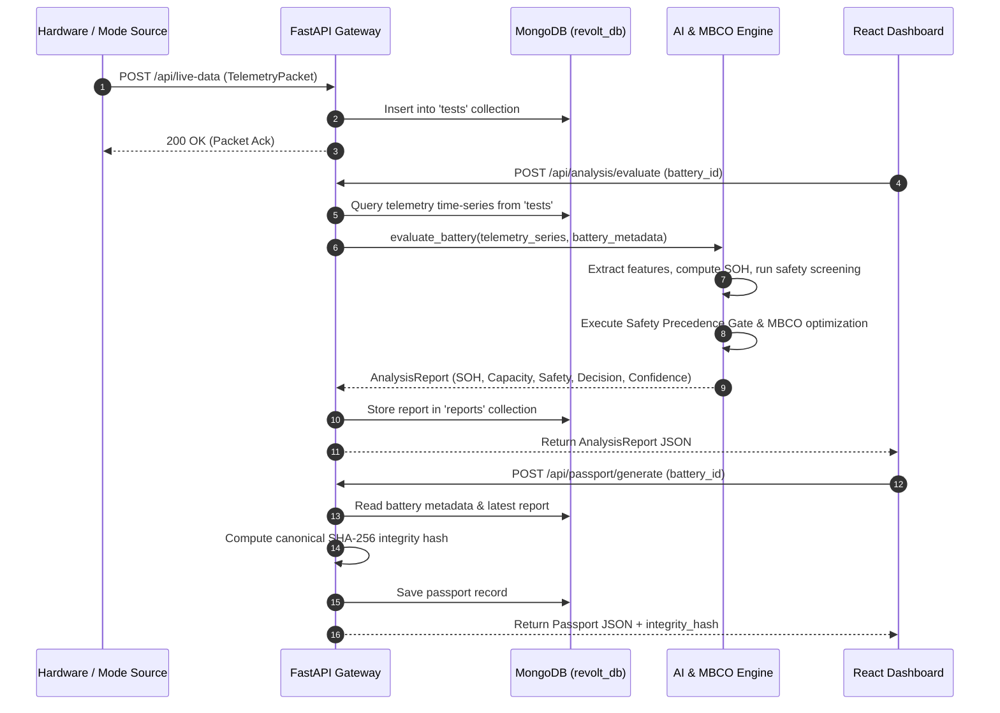

# System Architecture: ReVolt

## 1. Architectural Overview
ReVolt is designed as a modular, decoupled platform structured into five discrete tiers. Each tier has strict interface boundaries, enabling independent development and testing across hardware, backend, AI engine, and frontend.

---

## 2. Tier Details & Responsibilities

### Tier 1: Data Acquisition & Acquisition Modes
- **Owner:** Member 1 (Mona)
- **Functions:**
  - Interfaces physical sensors (INA226 voltage/current monitor and temperature probe via ESP32 I2C).
  - Emits telemetry packets over USB-serial or Wi-Fi HTTP bridge.
  - Generates synthetic and simulated streams for `REPLAY`, `VIRTUAL`, and approved `DATASET` modes.
- **Contract:** All streams deliver telemetry via `POST /api/live-data` conforming to `TelemetryPacket`.

### Tier 2: Gateway & Persistence Layer
- **Owner:** Member 2 (Project Owner)
- **Functions:**
  - High-performance asynchronous FastAPI REST gateway.
  - Validates all incoming payloads against Pydantic models.
  - Enforces database indexes and persists records in MongoDB (`revolt_db`).
  - Manages the five primary collections: `batteries`, `tests`, `reports`, `exchanges`, and `inventory`.
  - Coordinates transactions and audit trails for exchange approvals.

### Tier 3: Battery Intelligence & MBCO Engine
- **Owner:** Member 3
- **Functions:**
  - Deployed as an internal Python package (`ai_engine/`) invoked directly by FastAPI endpoints.
  - Performs feature extraction: internal resistance ($IR$), Coulomb counting, charge/discharge slopes ($dV/dt$), and thermal rise ($\Delta T$).
  - Estimates decoupled $SOH$ ($0.0 - 100.0\%$) and Available Capacity ($Ah$).
  - Applies deterministic safety rules producing `PASSED`, `WARNING`, `FAILED`, or `UNKNOWN`.
  - Calculates confidence score ($0.0 - 100.0\%$) based on data density and measurement variance.
  - Multi-Objective Battery Circularity Optimisation (MBCO) evaluates technical feasibility, safety constraints, economic return, and application matching.

### Tier 4: Digital Battery Passport & Verification
- **Owner:** Member 2 (Project Owner)
- **Functions:**
  - Generates tamper-evident battery passports upon technician approval or assessment completion.
  - Computes deterministic SHA-256 hashes over sorted, canonical JSON strings (`sort_keys=True`, `separators=(',', ':')`).
  - Exposes passport verification endpoint `POST /api/passport/verify` to detect payload alteration.

### Tier 5: Presentation & Stakeholder Dashboards
- **Owner:** Member 4 (Amrutha)
- **Functions:**
  - Single Page Application built with React, Vite, and Tailwind CSS.
  - Provides a 4-mode acquisition selector pill (`LIVE`, `REPLAY`, `VIRTUAL`, `DATASET`).
  - Renders 4 dedicated stakeholder tabs with live telemetry charts, what-if parameter sliders, cell grouping matrices, and passport QR badges.

---

## 3. End-to-End Data Flow

---

## 4. Fallback & Resilience Strategy
1. **Network / Hardware Offline:** When physical ESP32 hardware is disconnected, the system seamlessly transitions to `REPLAY` (pre-recorded bench cycle) or `VIRTUAL` mode to allow continuous demonstration and testing.
2. **Database Resilience:** MongoDB connections utilize `serverSelectionTimeoutMS=5000` with graceful error logging and connection health verification.
3. **Safety Fallback:** If sensor telemetry contains anomalous missing timestamps or incomplete discharge profiles, assessment confidence drops, triggering a mandatory `FURTHER_TESTING` state rather than risking false-positive reuse.

